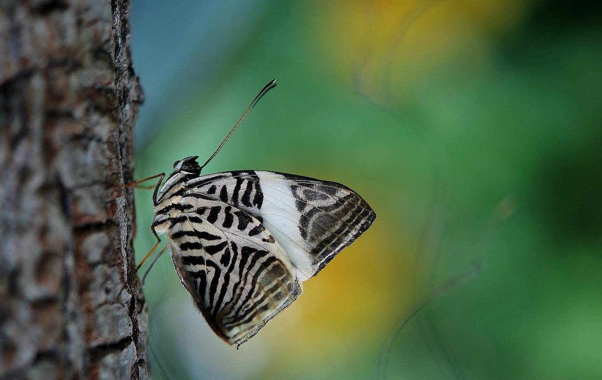

# Wind Scenario Generation and Reduction Scene Generation and Reduction for Unsupervised Clustering Algorithms, M-ISODATA, kmean, HAC

[Wind Scenario Generation and Reduction][m-ISODATA, kmean, HAC]Unsupervised clustering algorithms for capturing wind scenario generation and reduction research in power systems (Matlab code implementation)

## Images

<!-- PAYMENT_BLOCK -->

## Get this dataset

- Payment link (Stripe): [Buy now](https://buy.stripe.com/3cs8yP7sY87d0vu9AB)
- Payment QR code: 

<!-- /PAYMENT_BLOCK -->
